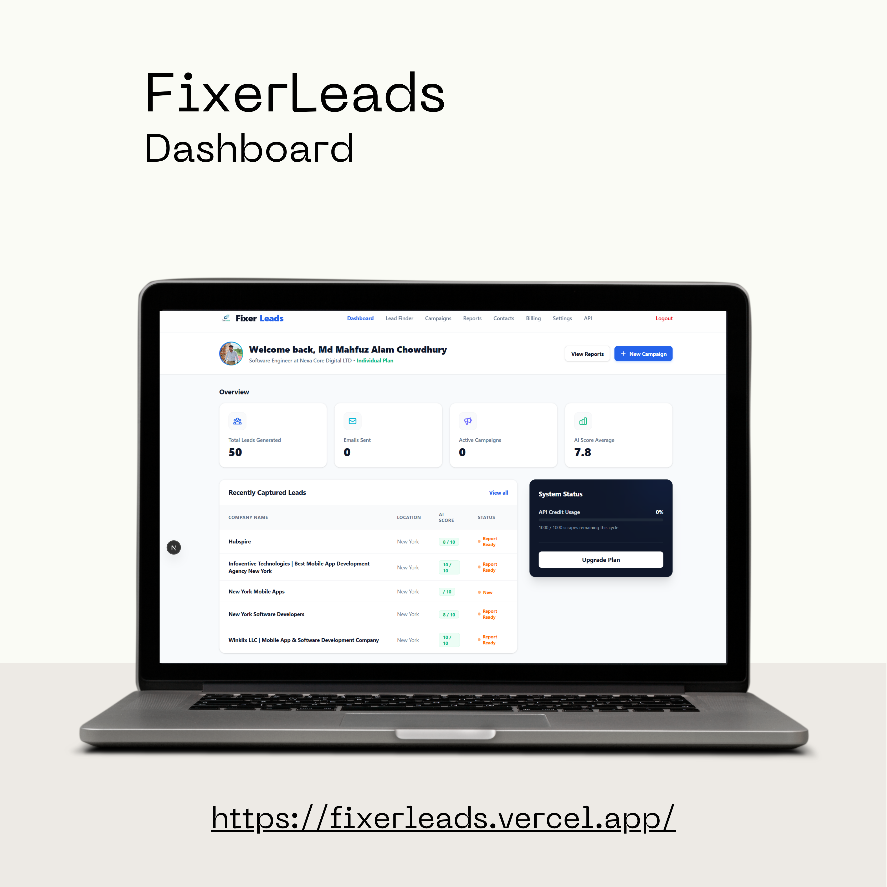
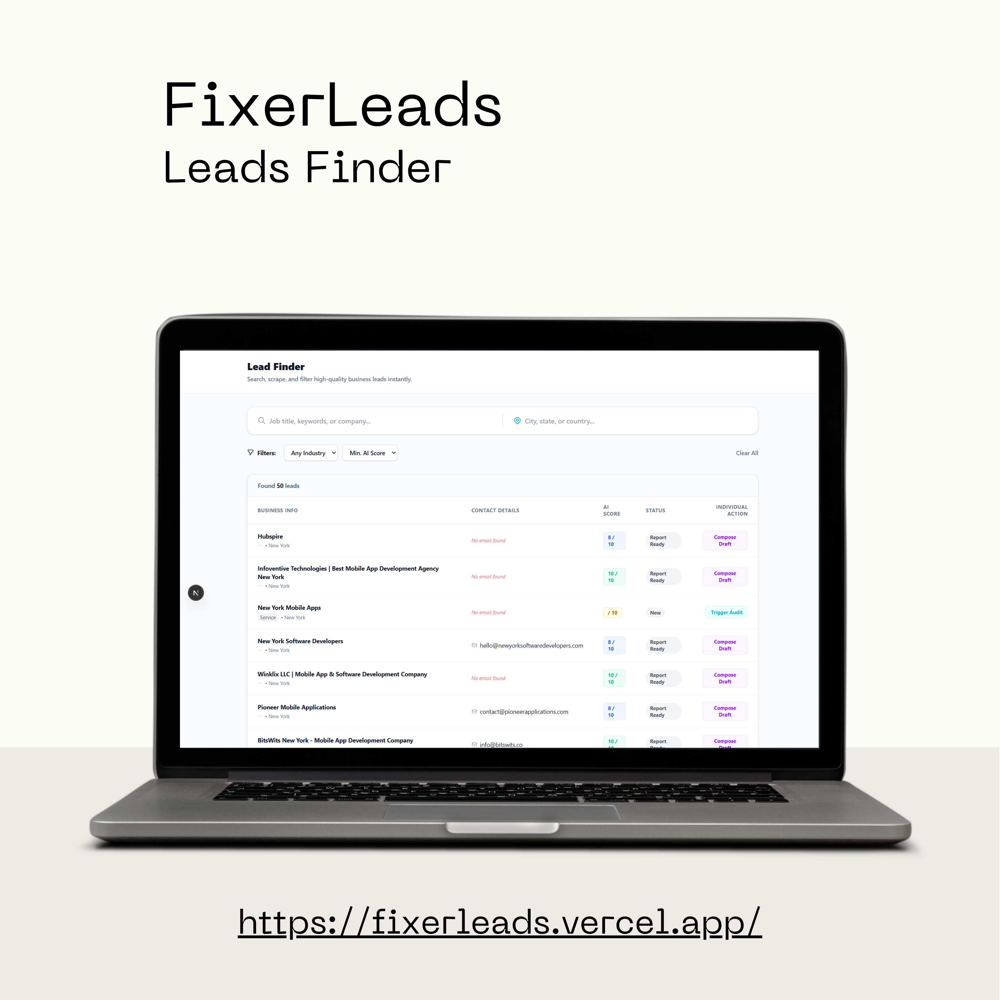

<div align="center">

# 🎯 FixerLeads: AI Lead Agents

### Find, audit, and reach your ideal customers on autopilot

AI agents that collect leads from **Google Maps** and **LinkedIn**, audit and rank them with **Claude**, and then generate and send personalized emails, PDF reports, and LinkedIn messages for you.


**A SaaS product by [Nexa Core Digital Ltd.](#-about-the-company)** · Status: 🟢 Live in production

🌐 **Live app:** `https://fixerleads.vercel.app` &nbsp;|&nbsp; 📬 **Contact:** [mahfuzalam.chowdhury.se@gmail.com](mailto:mahfuzalam.chowdhury.se@gmail.com)

</div>

---

## 📖 Overview

**FixerLeads** is an AI-powered lead generation and outreach platform for freelancers, agencies, and businesses. You describe your service, niche, and target locations, and the agents do the rest: **collect → audit → report → write → send**.

> 🔒 The source code is private. This repository is a public showcase of the product, its features, and its architecture.

---

## 📱 Screenshots


| | |
|:---:|:---:|
|  |  |
| **Dashboard** | **Campaigns** |
|  |  |
| **Lead Audit** | **Generated PDF Report** |
|  |  |
| **Sign In** | **Agent Settings** |

---

## ✨ Core Features

### 1️⃣ Google Maps Lead Collector

Finds local businesses that match your niche and location (via the **Google Places API (New)** and **Playwright**), then audits them with Claude.

**Three operating modes:**

| Mode | How it works |
|---|---|
| 🤖 **Auto** | One click starts everything. The agents collect leads, audit them, generate a PDF report for each lead, draft the email, and **send it automatically**. |
| 🎛️ **Manual** | You control each stage: collect, then audit, then report, then draft, then send. |
| 👤 **Individual** | Act on a single lead: collect one lead's data or send one email. |

**Each lead goes through this pipeline:**

```
Collect  ──▶  Audit & Rank  ──▶  PDF Report  ──▶  Draft Email  ──▶  Send via Gmail
 (Maps)        (Claude)         (ReportLab)        (Claude)         (Gmail API)
```

### 2️⃣ LinkedIn Lead Agent

- Finds targeted prospects on LinkedIn using the **Serper API**
- Collects profile data for each prospect
- Generates a personalized **connection request message**
- Generates **follow-up messages** after the connection is accepted

### 3️⃣ Product Promotion Agent

Promote your own product directly to the right customers:

1. Upload your **product PDF** and add a short **description**
2. Claude writes a tailored promotional email
3. The agents find targeted leads on **Google Maps and LinkedIn**
4. Your product PDF is **attached automatically** to the email when you click *Send* or run an *Auto campaign*

### 🔌 External API / Bring Your Own Agent

Use the FixerLeads agents inside your own terminal tools, scripts, or apps through API key authentication.
> Access is currently granted on request. **Contact us** to get a key. Public self-serve purchase is planned.

---

## ⚙️ Agent Settings

Each user configures their own agents from the **Settings** page:

- 🛠️ Service they offer
- 📝 Short service description
- 🎯 Target niche
- 📍 Target locations
- 📎 Product PDF and description (for product promotion)
- ✉️ Gmail connection (see below)

---

## 📧 Gmail Integration

FixerLeads sends emails from **your own Gmail account** through the **Gmail API**, so messages come from your real address.

The app includes an in-app **step-by-step guide** for creating your own Gmail API credentials and connecting them to FixerLeads.

---

## 🧠 AI Capabilities (Claude)

| Task | What Claude does |
|---|---|
| **Audit** | Analyzes collected business data and finds gaps and opportunities |
| **Rank** | Scores leads so the best prospects come first |
| **Email** | Writes a personalized outreach email for each lead |
| **LinkedIn** | Writes connection and follow-up messages |
| **Promotion** | Writes product promotion emails from your description |

---

## 🏗️ Architecture

```
┌──────────────────────┐   HTTPS / REST (JWT)   ┌───────────────────────────┐
│  Next.js (App Router)│ ─────────────────────▶ │  Django + DRF             │
│  Hosted on Vercel    │ ◀───────────────────── │  Hosted on Railway        │
└──────────────────────┘                        └─────────────┬─────────────┘
                                                              │
        ┌──────────────┬────────────────┬─────────────────────┼────────────────┐
        ▼              ▼                ▼                     ▼                ▼
 ┌────────────┐ ┌────────────┐  ┌──────────────┐     ┌───────────────┐  ┌────────────┐
 │ PostgreSQL │ │ Redis      │  │ Cloudinary   │     │ Celery Workers│  │ Stripe     │
 │ (data)     │ │ (broker)   │  │ (PDF/files)  │     │ (agents)      │  │ (payments) │
 └────────────┘ └────────────┘  └──────────────┘     └───────┬───────┘  └────────────┘
                                                             │
                          ┌──────────────┬───────────────────┼───────────────┐
                          ▼              ▼                   ▼               ▼
                   Google Places    Playwright         Serper API       Anthropic
                      API (New)      (scraping)       (LinkedIn)         Claude
                                                                         + Gmail API
```

---

## 🧰 Tech Stack

### Backend
| Area | Technology |
|---|---|
| Framework | Django 5, Django REST Framework |
| Database | PostgreSQL |
| Queue / Cache | Redis, Celery |
| Auth | JWT (SimpleJWT with refresh rotation and blacklist) + API-key auth for external access |
| AI | Anthropic Claude API |
| Data collection | Google Places API (New), Playwright, Serper API |
| Email | Gmail API |
| Reports | ReportLab (PDF) |
| File storage | Cloudinary |
| Payments | Stripe |
| Security | CORS allow-list, CSRF trusted origins, per-endpoint throttling |
| Static files | WhiteNoise |
| Hosting | Railway |

### Frontend
| Area | Technology |
|---|---|
| Framework | Next.js (`src/` directory, App Router) |
| Hosting | Vercel |

### Tools
- Postman: API design and testing

---

## 🛡️ Security Highlights

- JWT access and refresh tokens with rotation and blacklisting
- Master API key authentication for external integrations
- Rate limiting on campaign creation to prevent abuse
- Strict CORS and CSRF origin allow-lists
- Secrets kept in environment variables only

---

## 💳 Payments

Subscriptions and billing run on **Stripe**, with webhook-based confirmation.

---

## 🗺️ Roadmap

- [x] Google Maps lead collector (Auto / Manual / Individual)
- [x] LinkedIn lead agent
- [x] Product promotion agent
- [x] AI audit, ranking, and PDF reports
- [x] Gmail API sending
- [x] External agent API (on request)
- [ ] Public self-serve API key purchase
- [ ] More outreach channels

---

## 🏢 About the Company

**Nexa Core Digital Ltd.** builds and operates FixerLeads. For business inquiries or API access, get in touch using the contact details below.

---

## 👨‍💻 Author

**Mahfuz Alam Chowdhury**
Software Engineer · CSE Graduate
Python/Django · Flutter · AI Integration
📍 Sylhet, Bangladesh

- 🌐 GitHub: [github.com/mahfuzalam25](https://github.com/mahfuzalam25)
- 💼 LinkedIn: [linkedin.com/in/md-mahfuz-alam-chowdhury](https://www.linkedin.com/in/md-mahfuz-alam-chowdhury)
- 📧 Email: [mahfuzalam.chowdhury.se@gmail.com](mailto:mahfuzalam.chowdhury.se@gmail.com)
- 🏢 Portfolio: [mahfuzalam25.pythonanywhere.com](https://mahfuzalam25.pythonanywhere.com/)

---

<div align="center">

© 2026 Nexa Core Digital Ltd. All rights reserved.
This repository is a showcase only. The source code is proprietary and not licensed for reuse.

</div>